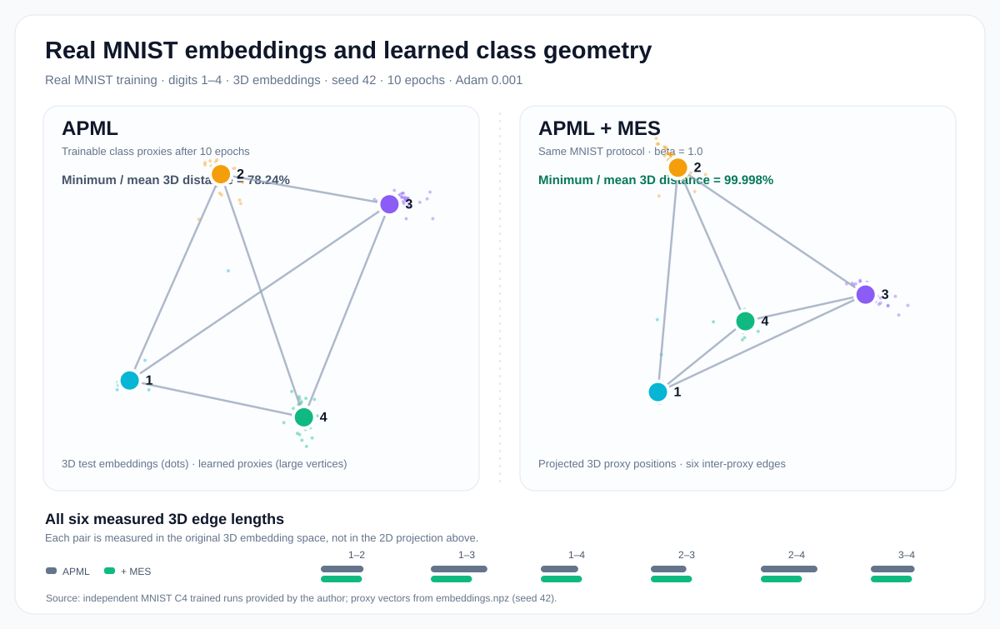
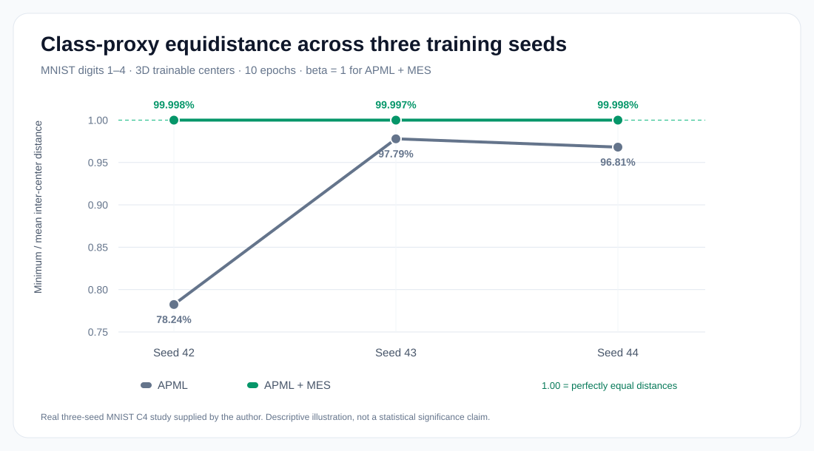

# MES-loss

**Mutually Equidistant Separation Metric Learning Loss Function**

Yasser Boutaleb, Catherine Soladié, Nam-Duong Duong, Amine Kacete, Jérôme Royan, Renaud Séguier  
*Pattern Recognition Letters*, 172, 58–64 (2023) · [Read the paper](https://doi.org/10.1016/j.patrec.2023.06.005) · [BibTeX](CITATION.bib)

> **Private scientific preview.** This educational implementation has not yet been approved for redistribution. It does not claim to reproduce the paper's benchmark results.

## The idea

**Learn to distinguish classes, while encouraging their learned representatives to form a more uniform geometry.**

The method combines **two complementary objectives using the same trainable class centers**:

| **APML — Discriminate** | **MES — Organize** |
|:---|:---|
| Learns embeddings that favor the correct class through distance-based Cauchy probabilities. | Reduces differences between the squared distances of every pair of class centers. |
| **Question:** Which class does this sample belong to? | **Question:** How evenly are the class centers arranged? |

There are no extra margins, normalization constraints, or fixed target distances in the original formulation.

## How it works — three steps

Let $z_i=f_\theta(x_i)$ be the embedding of input $x_i$, and let $w_k$ be the **learnable** representative (proxy) of class $k$. These are model parameters, not minibatch averages.

### 1. APML: learn discriminative embeddings

Each embedding is assigned a Cauchy-affinity probability for every class:

$$
p_{ik}=\frac{(1+\|z_i-w_k\|^2)^{-1}}{\sum_j(1+\|z_i-w_j\|^2)^{-1}}
$$

APML penalizes low probability for the correct class:

$$
\mathcal{L}_{\mathrm{APML}}=-\frac{1}{N}\sum_i\log p_{i,y_i}
$$

In PyTorch, the same probabilities can be implemented stably using logits $-\log(1+\|z_i-w_k\|^2)$ with cross-entropy.

### 2. MES: encourage uniform distances between class centers

Consider every distinct pair of trainable centers, and compute its **squared** Euclidean distance:

$$
q_{jk}=\|w_j-w_k\|^2 \qquad (j<k)
$$

MES is simply the population variance of these pairwise squared distances:

$
\mathcal{L}_{\mathrm{MES}}=\frac{1}{M}\sum_{j<k}(q_{jk}-\bar{q})^2
$

That is, the loss becomes small when the pairwise squared distances become similar. **MES does not prescribe how large those distances must be.** The exact finite-sum definition is in [the mathematical notes](docs/mathematical_formulation.md).

### 3. Train the two objectives together

$$
\mathcal{L}=\alpha\,\mathcal{L}_{\mathrm{APML}}+\beta\,\mathcal{L}_{\mathrm{MES}}
$$

**One set of class centers, two jobs:** APML learns discrimination; MES encourages a more regular arrangement of those same centers.

## A real MNIST experiment: four learned class centers in 3D

The figures below come from **trained neural networks**, not a hand-drawn tetrahedron. We used MNIST digits **1, 2, 3 and 4**, a directly learned three-dimensional embedding, **10 training epochs**, Adam with learning rate **0.001**, and **MES weight beta = 1**. The methods used the same dataset selection and the example below shows seed **42**.

*Figure 1 — Actual learned **class-proxy weights**, projected into 2D only for display. Each colored vertex is the learned proxy for one MNIST digit; each line connects a proxy pair. The six edge lengths are measured in **the original 3D space**, not in the 2D projection. After training, the minimum/mean pair-distance ratio is **0.7824 for APML** and **0.99998 for APML + MES** (seed 42). The projections need not look like a perfectly regular 2D tetrahedron.*

**Why does this happen?** Four distinct equidistant centers can form a regular tetrahedron in three dimensions. MES penalizes differences between **squared** pair distances, encouraging a configuration close to this geometry when APML maintains distinct centers. MES **does not** itself force the centers to remain separated or guarantee a tetrahedron.

### Is this pattern specific to one initialization?

We repeated this controlled four-class protocol with seeds **42, 43 and 44**:

*Figure 2 — Ratio of the smallest to mean **Euclidean** distance between learned class proxies, computed independently for each seed. A value of **1** means equidistant centers. APML + MES reaches about **0.99998** for all three seeds; APML alone varies from **0.782** to **0.978**. Three seeds support this descriptive observation but do not establish general statistical significance or improved retrieval on unseen classes.*

These are **educational MNIST experiments**, not an exact reproduction of the paper's benchmark protocol. Figure measurements are from the author's archived trained runs; the separate [quickstart video recipe](docs/cluster_movie_guide.md) uses a different educational preset. See [experimental provenance and exact metrics](docs/mnist_c4_evidence.md).

## Reproduce the method

Start with Python 3.10+ and a compatible PyTorch installation. The first two examples run on **CPU**, without downloading a dataset.

**Check the loss and gradients:**

~~~bash
python -m pip install -e ".[dev]"
python scripts/reproduce.py check
~~~

**Run a tiny synthetic model and regenerate the mathematical figures:**

~~~bash
python scripts/reproduce.py quickstart
python scripts/reproduce.py figures
~~~

**Optional: record real four-class MNIST training in 3D:**

~~~bash
python -m pip install -e ".[dev,movie]"
python scripts/reproduce.py mnist --out runs/mnist_1234_seed42 --video
~~~

This last command trains **APML vs APML + MES**, starting from the same weights and using the same minibatches, and captures genuine embedding and center positions throughout training. It uses the MNIST *training split only*; the video is an **educational example**, not a benchmark reproduction. Encoding MP4 requires FFmpeg.

For a fast dataset-free training smoke test, use the smoke command in [the reproduction instructions](docs/usage_and_reproducibility.md). Existing run directories are protected against overwriting.

[Reproduction instructions](docs/usage_and_reproducibility.md) · [Video protocol](docs/cluster_movie_guide.md) · [Python implementation](src/mes_apml/torch_backend.py)

## Learn more

- [Complete mathematical formulation and gradients](docs/mathematical_formulation.md)
- [Geometry and dimensionality](docs/geometric_intuition.md)
- [Figure provenance: analytic vs synthetic vs trained](figures/README.md)
- [Scientific limitations](docs/limitations.md)
- [Paper reference](docs/references.md)

**Citation:** Boutaleb *et al.*, “MES-loss: Mutually Equidistant Separation Metric Learning Loss Function,” *Pattern Recognition Letters* **172**, 58–64 (2023). [DOI](https://doi.org/10.1016/j.patrec.2023.06.005).

**Publication status:** no public release, merger, or software license is approved by this draft. See [publication checklist](docs/GIT_PUBLICATION_CHECKLIST.md).
