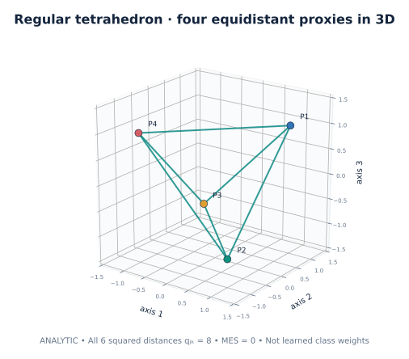
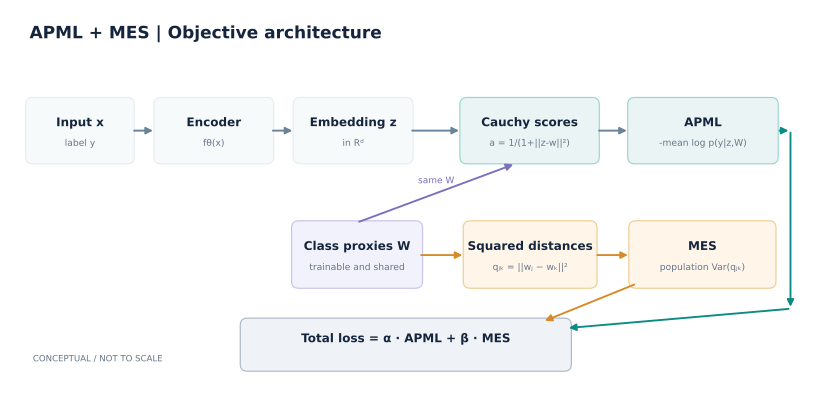
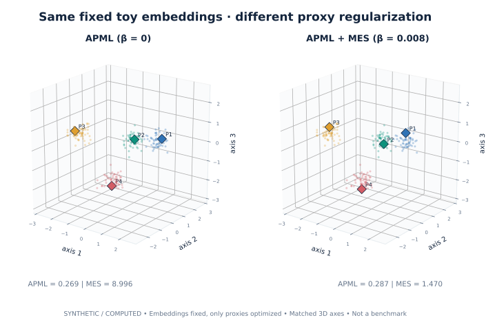

# MES-loss

**Mutually Equidistant Separation Metric Learning Loss Function**

**Yasser Boutaleb, Catherine Soladié, Nam-Duong Duong, Amine Kacete, Jérôme Royan, Renaud Séguier**  
*Pattern Recognition Letters*, **172**, 58–64 (2023) · [Paper and DOI](https://doi.org/10.1016/j.patrec.2023.06.005)

> **Prepublication review:** this repository is currently private and its software license and rights clearance have **not** been approved. The examples below document an independent educational implementation; they are not a reproduction of the paper's benchmark scores.

**One idea, two complementary objectives.** A neural encoder learns where each sample belongs; the *same trainable class proxies* jointly shape the geometry of the embedding space. APML scores each example using distance-based Cauchy affinities. MES encourages the **squared distances between distinct class proxies to become mutually equal**.

*Four classes in three dimensions can form a regular tetrahedron. This picture is an **analytic construction**, not a neural-network result; see the [geometric proof](docs/mathematical_formulation.md#why-a-tetrahedron-four-classes-in-3d).*

## The method in one equation

For labeled samples $(x_i,y_i)$, set $z_i=f_\theta(x_i)\in\mathbb R^d$ and let $W=(w_1,\ldots,w_C)$ be **learnable class-proxy weights** (not minibatch centroids). Define

$$
\ell_{ik}=-\log\!\left(1+\|z_i-w_k\|_2^2\right),\qquad
q_{jk}=\|w_j-w_k\|_2^2,\quad
\bar q=\frac{1}{M}\sum_{j<k}q_{jk},\quad M=\binom C2.
$$

The original, published objective is

$$
\boxed{
\mathcal L(\theta,W)
=
\underbrace{\alpha\,\frac1N\sum_{i=1}^{N}
  \operatorname{CE}(\ell_i,y_i)}_{\text{APML: discriminative embeddings}}
+
\underbrace{\beta\,\frac1M\sum_{j<k}
  (q_{jk}-\bar q)^2}_{\text{MES: inter-proxy distance uniformity}}
}
$$

The same $W$ appears in both terms. MES operates directly on the proxies; its effect on encoder learning is mediated through subsequent APML updates. **There is no fixed target distance, radius, cosine normalization, or additional margin in this baseline.**

**Why a tetrahedron?** $C$ distinct, pairwise-equidistant points require an embedding dimension $d\ge C-1$. For $C=4$, three dimensions suffice and the nondegenerate equal-distance geometry is a regular tetrahedron. This is a property of Euclidean geometry, **not a promise of optimization convergence**. [Proof and exact gradients](docs/mathematical_formulation.md).

## Reproduce in a few commands

**Requirements:** Python 3.10+ and a compatible PyTorch installation. CPU suffices for the mathematical tests and synthetic example. The commands use the exact loss functions defined in [the implementation](src/mes_apml/torch_backend.py).

### 1 · Check the mathematics (no dataset needed)

~~~bash
python -m pip install -e ".[dev]"
python scripts/reproduce.py check
~~~

This runs the numerical, gradient, and geometry tests. It does **not** download MNIST or evaluate any benchmark test set.

### 2 · Run the minimal example and regenerate the figures

~~~bash
python scripts/reproduce.py quickstart
python scripts/reproduce.py figures
~~~

The example trains a tiny synthetic encoder on CPU. The figure command regenerates the **analytic and synthetic** illustrations; their provenance is documented in [figure inventory](figures/README.md).

### 3 · Optional: watch genuine 3D training

**Offline smoke demo** (generated geometric shapes, *not* MNIST):

~~~bash
python -m pip install -e ".[dev,movie]"
python scripts/reproduce.py smoke --out runs/shapes_smoke_42
~~~

**Four-class MNIST training** (downloads only the official **training** split on first run):

~~~bash
python scripts/reproduce.py mnist --out runs/mnist_1234_seed42 --video
~~~

The MNIST demonstration trains **APML vs APML + MES**, starting from identical model weights and using identical minibatches. It records real model states and the six squared pair distances; it is **not** the article's separate Softmax-vs-APML+MES comparison, and its hyperparameters are an educational preset rather than published benchmark settings. MP4 encoding requires FFmpeg on your PATH.

These commands do not overwrite existing run directories. For additional control over epochs, dataset sizes, and live viewing, see the [full MNIST movie guide](docs/cluster_movie_guide.md) or invoke the underlying CLI directly.

## What MES does—and does not—guarantee

- MES is exactly the **population variance of the $M$ distinct squared proxy distances**.
- If all $q_{jk}$ equal a positive number, MES is zero and the proxies form a regular simplex (when $d\ge C-1$).
- **Collapse is also zero-loss:** coincident proxies have MES = 0. MES alone cannot enforce a positive distance or guarantee max-min separation.
- Rescaling all proxies by $s$ scales the original MES objective by $s^4$; the loss is **not scale-invariant**.
- APML+MES can encourage useful class geometry, but no theorem here guarantees a particular trained polyhedron, superior retrieval, or improved generalization.

For an interpretable, dimensionless *diagnostic* (not an alternate loss), plot $\mathrm{CV}_q=\sqrt{\mathcal L_{\rm MES}}/\bar q$ when $\bar q>0$. See [mathematical formulation](docs/mathematical_formulation.md) and [limitations](docs/limitations.md).

## Evidence and documentation

*Controlled **synthetic** illustration: the embeddings are fixed while the class proxies are optimized. This is not an MNIST, CUB-200-2011, Cars196, or generalization benchmark result.*

- [Mathematics: definitions, gradients, simplex proof, and distance bound](docs/mathematical_formulation.md)
- [Reproducibility: exact commands, environment and provenance](docs/usage_and_reproducibility.md)
- [Figure sources, limitations, and verification](figures/README.md)
- [MNIST real-snapshot video protocol](docs/cluster_movie_guide.md)
- [References and published article](docs/references.md)

**Cite the journal article** when discussing MES-loss:  
Boutaleb, Y., Soladié, C., Duong, N.-D., Kacete, A., Royan, J., and Séguier, R. (2023). *MES-loss: Mutually Equidistant Separation Metric Learning Loss Function*. **Pattern Recognition Letters 172**, 58–64. https://doi.org/10.1016/j.patrec.2023.06.005

**Publication gate:** repository visibility, code ownership, license, software authorship, and any use of publisher figures remain subject to explicit approval. No internal research-lab campaigns, CUB official test data, unpublished MES variants, or proprietary checkpoints belong in this repository. See [publication checklist](docs/GIT_PUBLICATION_CHECKLIST.md).
