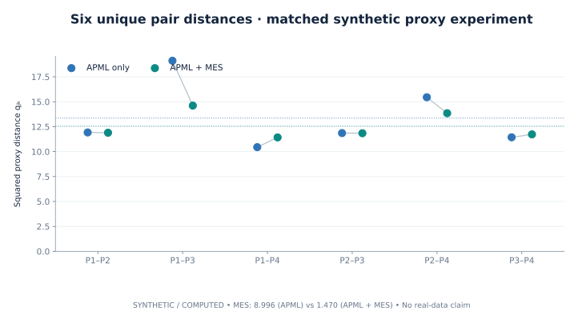
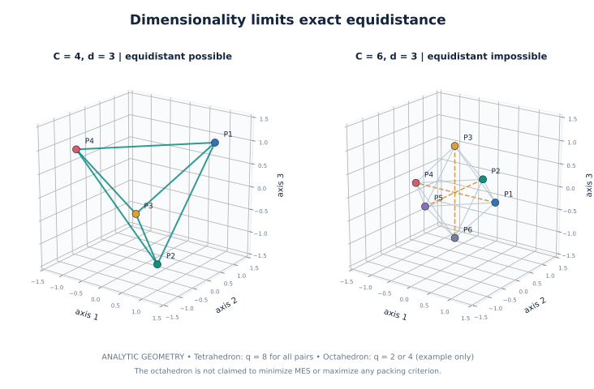

# APML + MES: Cauchy-affinity metric learning with equidistant class-proxy regularization

**Scientific preview — not licensed for redistribution or publication.** This is an independent, minimal, educational implementation of the *original* APML and MES objectives. The presentation and implementation are under review against the complete published article and doctoral dissertation. No trained benchmark results are claimed here.

**Automated Penalty-based Metric Learning (APML)** makes samples discriminative through **Cauchy affinities** to trainable class proxies. **Mutually Equidistant Separation (MES)** adds a complementary geometric objective: it reduces the **variance of squared pairwise distances** between those same proxies. Together, they couple sample-level classification with a global constraint on class-proxy geometry—**without guaranteeing maximal separation or preventing proxy collapse on its own**.


*Figure 1 — Computed **synthetic toy example**, not a trained MNIST, CUB or Cars result. Same fixed 3D embeddings, initialization, optimizer, and axes across conditions; only the MES coefficient differs. See [reproduction protocol](docs/usage_and_reproducibility.md).*

## Why combine APML and MES?

- **APML** penalizes incorrect class predictions using normalized Cauchy affinities between embeddings and learnable class proxies.
- **MES** encourages more uniform **squared** distances between all distinct class proxies; it does not impose a target radius or a minimum distance.
- **The combination** regularizes the geometry of the classification head while APML provides the data-dependent discriminative objective.


## How it works

Given a batch of labeled observations $(x_i,y_i)$, an encoder $z_i=f_\theta(x_i)\in\mathbb{R}^d$, and **trainable** class proxies $W=(w_1,\dots,w_C)\in\mathbb{R}^{C\times d}$ (not batch means):

### 1. APML — Cauchy-affinity classification

$$
a_{ik}=\frac{1}{1+\|z_i-w_k\|_2^2},\qquad
p_{ik}=\frac{a_{ik}}{\sum_{j=1}^{C}a_{ij}},\qquad
\boxed{\mathcal L_{\mathrm{APML}}=-\frac1N\sum_{i=1}^{N}\log p_{i,y_i}}.
$$

A stable implementation uses class logits $-\log(1+\|z_i-w_k\|_2^2)$ and cross-entropy. No extra temperature, margin, or automatic $L_2$ normalization is part of this baseline.

### 2. MES — variance of *squared* inter-proxy distances

For each **unordered distinct** pair $j<k$, define $q_{jk}=\|w_j-w_k\|_2^2$, $M=\binom{C}{2}$, and $\mu=M^{-1}\sum_{j<k}q_{jk}$. Then

$$
\boxed{\mathcal L_{\mathrm{MES}}(W)=\frac1M\sum_{j<k}(q_{jk}-\mu)^2}.
$$

This is the **population variance** of the $M$ squared distances—not sample variance and not the variance of the unsquared distances.

### 3. Joint objective

$$
\boxed{\mathcal L=\alpha\mathcal L_{\mathrm{APML}}+\beta\mathcal L_{\mathrm{MES}}},\qquad \alpha,\beta\geq 0.
$$

Both terms use the same trainable $W$. MES acts directly on $W$; APML provides gradients to both $W$ and the encoder through $z_i$.

## Geometric intuition


*Figure 3 — Analytic reference: four distinct equidistant proxies can exist in three dimensions. All six squared pair distances are $8$ in the displayed coordinate construction; $\mathcal L_{\mathrm{MES}}=0$. This is **not** a claim that MES always finds a tetrahedron.*



*Figure 4 — Six unique squared proxy distances from the **same toy experiment** as Figure 1.*



*Figure 5 — In $\mathbb R^3$, four distinct points can be mutually equidistant; six cannot. An octahedron is only an illustrative six-point configuration, **not a universal MES optimum**.*

## Quick start (CPU)

Requires Python 3.10+ and PyTorch. From a local copy of this **unpublished draft**:

```bash
python -m pip install -e .
python examples/quickstart_torch.py
```

```python
import torch
from mes_apml import combined_loss

z = torch.tensor([[0., 0.], [1., 1.]], requires_grad=True)
y = torch.tensor([0, 1])
W = torch.nn.Parameter(torch.tensor([[0., 0.], [1., 0.], [0., 1.]]))

loss = combined_loss(z, y, W, alpha=1.0, beta=0.1)
loss.backward()  # gradients reach embeddings and the shared trainable proxies
print(f"loss={loss.item():.6f}; proxy-grad-norm={W.grad.norm().item():.6f}")
```

The included example runs a deterministic small synthetic training loop. It downloads no data and makes no generalization or benchmark claims.

## Reproduce the figures and check the mathematics

```bash
python -m pip install -e '.[dev,viz]'
python -m pytest -q
python scripts/make_figures.py --out figures
```

The source, seeds, numerical definitions, and figure inventory are in [reproducibility](docs/usage_and_reproducibility.md) and [figure provenance](figures/README.md). The figures illustrate **calculated synthetic or analytic configurations only**; the controlled MNIST demonstration script is provided separately, but genuine MNIST results are not claimed until run and validated.

## Film true 3D cluster formation (new in preview v0.2)

The new [live training/video guide](docs/cluster_movie_guide.md) explains how to
train a tiny encoder from scratch on **four MNIST digits**, comparing APML only
against APML + the **original** MES variance regularizer. Both arms start from
identical weights and see the same minibatches. The figures below remain
synthetic/analytic; the video tool is a **separate** experiment.

```bash
python -m pip install -e '.[movie,dev]'
python scripts/cluster_movie.py train --dataset mnist --digits 1,2,3,4 \
  --epochs 8 --train-per-class 1200 --val-per-class 200 \
  --display-per-class 120 --snapshot-every 5 \
  --out runs/mnist_movie_seed42 --video --dpi 150
```

MNIST downloads automatically on first use. While training, observe
`runs/mnist_movie_seed42/live/latest.png` (or use the supplied
`examples/monitor_training.ipynb` notebook). The final output is an H.264
`movie.mp4` with real tracked embeddings, real trainable proxies, and plots
of the six squared pair distances and MES variance. **No official MNIST test
split, no CUB/Cars data, and no private experimental loss variants** are used.

The 3D models are actually trained; frame coordinates are not animated by
artificial interpolation. The video remains an *educational illustration*, not
a benchmark or a proof that MES always improves class separation. This MNIST
path has not been run end-to-end with downloaded data in the current offline
validation environment; its code and offline procedural-shape path have been
tested.

## Important mathematical limits

- **Translation invariance:** $\mathcal L_{\mathrm{MES}}(W+a)=\mathcal L_{\mathrm{MES}}(W)$ for the same $a$ added to every proxy.
- **Not scale invariant:** $\mathcal L_{\mathrm{MES}}(sW)=s^4\mathcal L_{\mathrm{MES}}(W)$.
- **Collapse:** coincident proxies give $\mathcal L_{\mathrm{MES}}=0$; MES alone does **not** prevent this degeneracy.
- **Two classes:** with one pair only, MES is identically zero, regardless of separation.
- **Uniformity is not max-min packing:** decreasing pairwise distance variance does not necessarily increase the smallest inter-class distance.
- **Dimensionality:** $C$ distinct mutually equidistant points require $d\ge C-1$. For $C=6$ or $8$ this cannot happen in three dimensions.

See [mathematical formulation](docs/mathematical_formulation.md), [geometric intuition](docs/geometric_intuition.md), and [limitations](docs/limitations.md).

## Scope, citation, and licensing

This draft intentionally excludes experimental or unpublished MES variants, private campaigns, large datasets, and production infrastructure. PyTorch is the initial implementation; TensorFlow parity remains future work. A four-class MNIST **demonstration script** is included but no MNIST performance is claimed from this preview.

**Primary article:** Boutaleb, Y.; Soladié, C.; Duong, N.-D.; Kacete, A.; Royan, J.; Séguier, R. (2023). *MES-Loss: Mutually equidistant separation metric learning loss function*. **Pattern Recognition Letters**, 172, 58–64. [https://doi.org/10.1016/j.patrec.2023.06.005](https://doi.org/10.1016/j.patrec.2023.06.005). See [references](docs/references.md).

**No license has been granted for this draft.** No `LICENSE`, `CITATION.cff`, GitHub publication, redistribution, or package release is authorized until rights, final citation metadata, and the public repository are approved by the project owner. Existing publisher rights and third-party contributions remain subject to their respective terms.