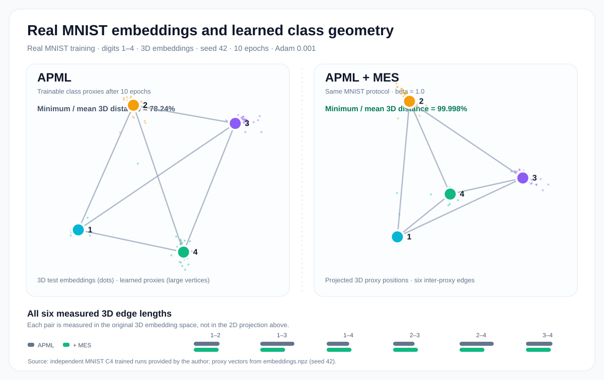

# Geometric intuition: what MES does to learned class proxies

**APML learns to discriminate; MES encourages class-proxy distances to become more uniform.** The terms share the same trainable proxy vectors, but play different roles. MES equalizes squared distances and does not set their absolute scale or prevent collapse by itself.

## A concrete learned example, not a hand-drawn tetrahedron

Four MNIST digits were trained with direct 3D embeddings. The small dots are genuine recorded test embeddings from trained networks, and the colored vertices are their learned class proxies. The six edges connect all four centers. The displayed six distances are computed from the **original 3D learned weights**, not the 2D orthographic projection used for the image.

In this run, APML alone achieved a smallest/mean class-proxy Euclidean distance ratio of 0.7824, versus 0.99998 with APML + MES. This measures the **geometry of learned proxy vectors**, not improved generalization on unseen classes.

[See the three-seed evidence, settings and exact distances](mnist_c4_evidence.md).

## Why a tetrahedron?

A tetrahedron is the three-dimensional regular simplex: four *distinct* vertices and six equal pairwise edges. Such a configuration is geometrically feasible for four classes in 3D, but it is only **one kind of zero-MES state**. A collapsed configuration of four identical centers also has MES = 0.

The condition for $C$ distinct equidistant points in $d$ dimensions is $d\ge C-1$. Thus six distinct equidistant centers cannot exist in 3D. A regular octahedron is not a collection of six mutually equidistant points.

The detailed [mathematical formulation](mathematical_formulation.md#6-why-four-classes-can-form-a-tetrahedron-in-3d) contains the centered-Gram-matrix rank proof and exact gradients.

## Measuring uniformity separately from discrimination

For a fixed trained model, report both the minimum/mean inter-proxy Euclidean distance and whether the proxy geometry is nondegenerate (e.g., minimum distance greater than zero and meaningful 3D volume).

A smaller MES value alone is **not** enough to claim improved minimum separation or better retrieval, because the original MES variance is scale-dependent.

[Back to README](../README.md)
